# Mammalian Keratin Project

Sequence, structural, phylogenetic and synteny analysis of keratin genes across mammals.

**Author:** Tanishq Milani

| | Project | Focus | Web page |
|---|---|---|---|
| 1 | [Summer '26](#summer-26-mammalian-keratin-analysis) | Dataset building, Type I/II classification, head/tail analysis, coiled-coil prediction, MSAs, phylogenies, synteny | [index.html](https://kazu-ds.github.io/keratin-project/) |
| 2 | [Semester Project '26](#semester-project-26-heptad-alignment-of-the-coiled-coils) | Heptad-register alignment of the coiled-coil domains as a basis for better phylogenies | [august26.html](https://kazu-ds.github.io/keratin-project/august26.html) |

---

## Summer '26: Mammalian keratin analysis

Identify, filter, classify and analyse keratin datasets across mammals using sequence data.

### Data processing and filtering

- Parsed UniProt (UniRef100) datasets to extract keratin sequences.
- Filters applied:
  - removed fragments, KAPs, low-quality, microfibrillar and cochlear keratins
  - minimum sequence length of 300
  - for clones and isoforms, kept the longest sequence
  - standardised nomenclature
- Because of updates in UniRef and SwissProt, reference proteomes were used instead, to avoid data inconsistencies.

### Classification and dataset organisation

- Classified keratins into **Type I** and **Type II**.
- Split the dataset into organism-wise and keratin-wise files.
- Applied a minimum keratin count threshold of 15 per organism.
- **Final dataset: 120 organisms, 4442 keratins.**

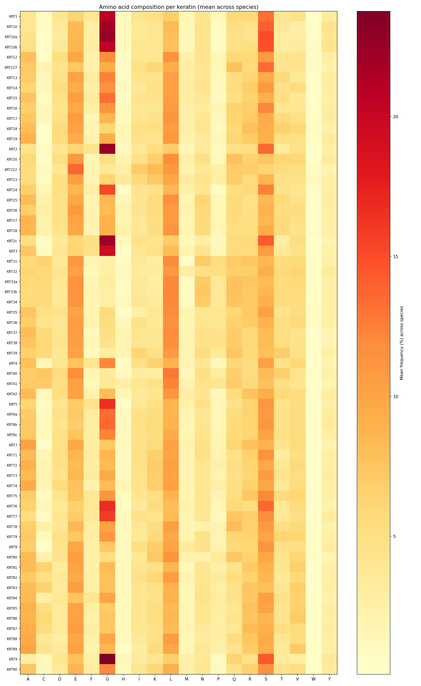

  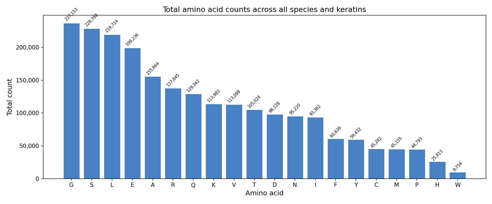
  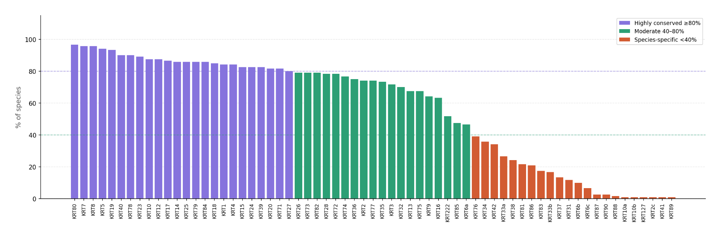

### Head and tail domain analysis

- Keratin-wise MSAs on the filtered data.
- Head and tail regions mapped onto the aligned sequences using human keratins as reference, then extracted with gaps removed.

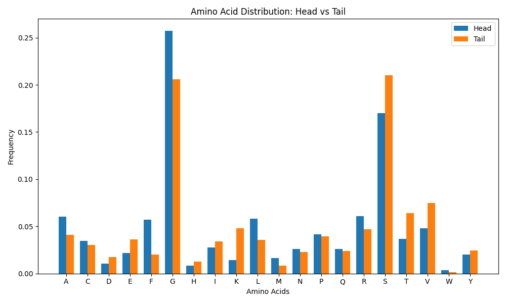

- Average head and tail lengths per keratin, compared across canonical Type I / Type II pairs: strong positive correlation (head r = 0.84, tail r = 0.83).

  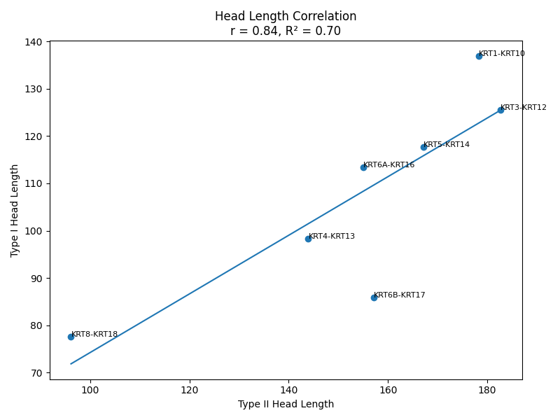
  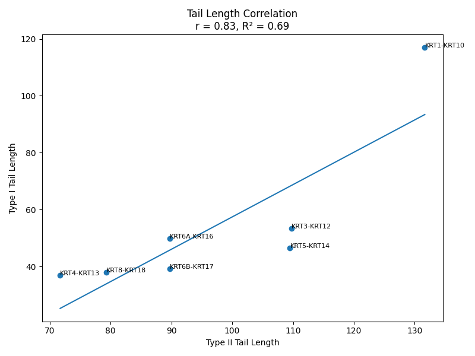

- Direct comparison of Type I vs Type II head and tail lengths:

  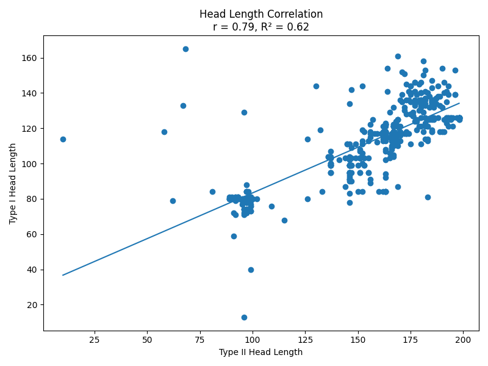
  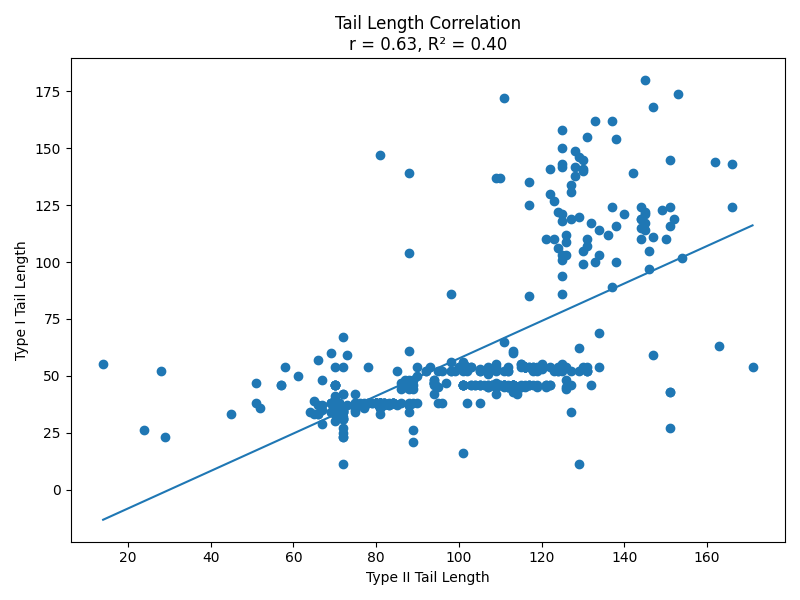

- STY (Ser/Thr/Tyr) frequency across canonical pairs: head moderate (r = 0.52), tail weak (r = 0.22).

  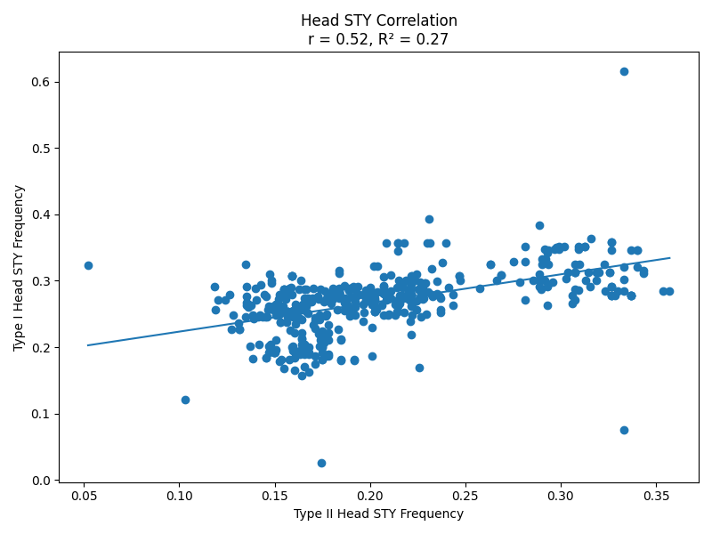
  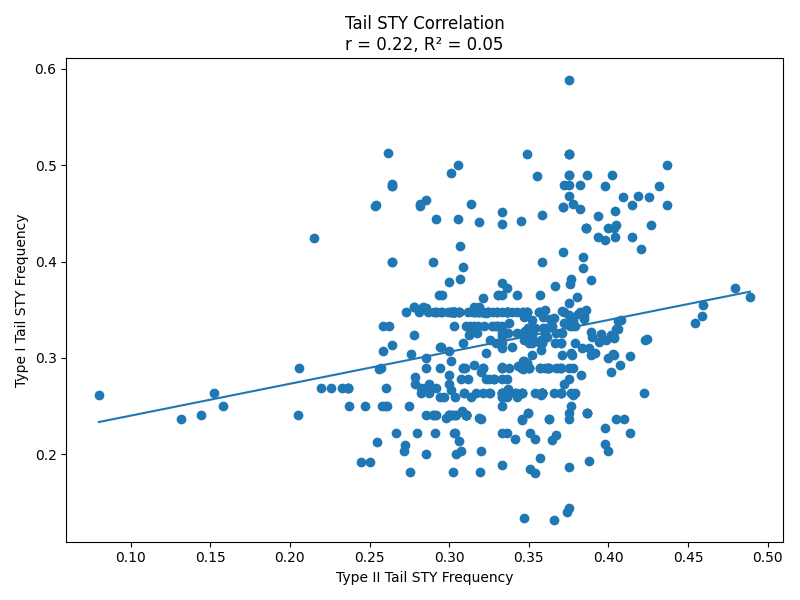

- Serine vs head length: positive correlation with serine count (r = 0.67, R² = 0.45), weak negative correlation with serine fraction (r = −0.29, R² = 0.09).

  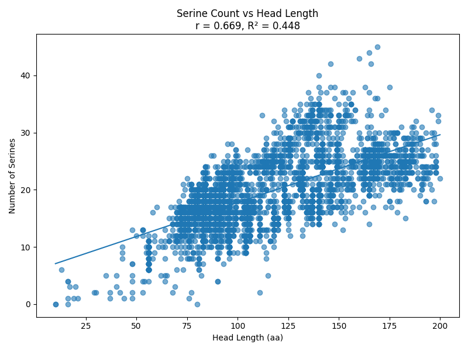
  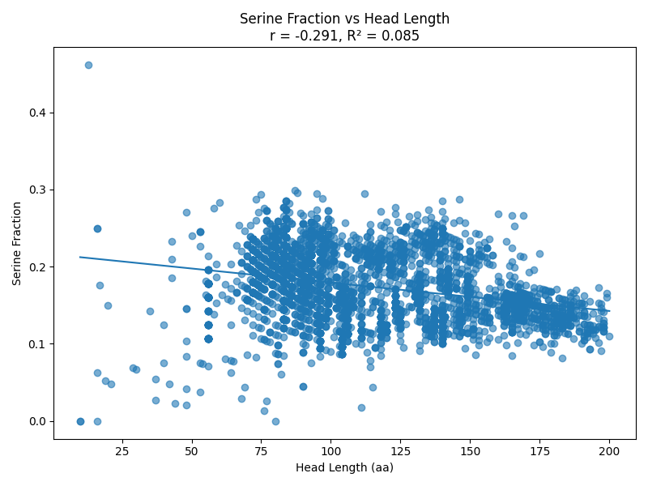

### Coiled-coil prediction

- Coiled-coil regions predicted for all sequences with **CoCoNat**.
- Independent MSA-based annotation: human coiled-coil boundaries (1A, 1B, 2A, 2B) mapped onto keratin-wise MSAs to extract the same regions from all orthologues.
- Length difference (CoCoNat − MSA) peaks around **−80 aa**: CoCoNat generally predicts shorter coiled-coils.

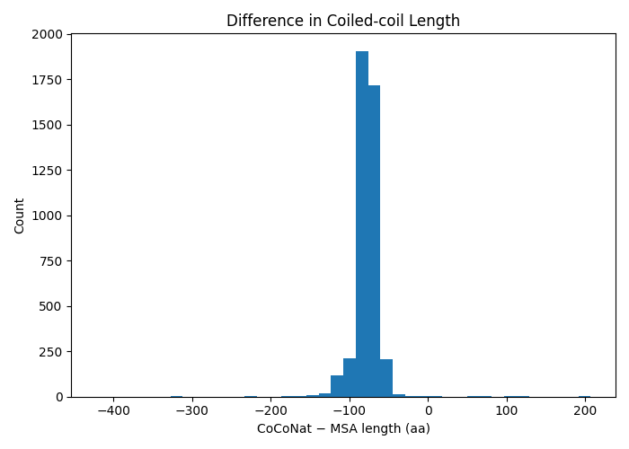

### Multiple sequence alignment and phylogenetics

MAFFT alignments for each keratin family across organisms, all keratins within each organism, all Type I, all Type II, and the full dataset.

Maximum-likelihood trees with **IQ-TREE** (best-fit model chosen automatically, MFP):

| Dataset | Tree |
|---|---|
| `keratinwise_human` | one tree per human keratin family |
| `keratinwise_nonhuman` | one tree per keratin family across non-human mammals |
| `type1keratinmsa` | all Type I keratins |
| `type2keratinmsa` | all Type II keratins |
| `allkeratinmsa` | all keratins |

Example, KRT1:

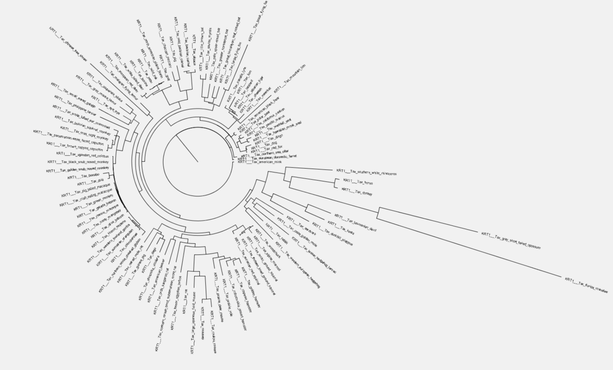

### Synteny analysis

**Objective:** determine the genomic organisation of keratin genes across species and identify conserved keratin loci.

- Retrieved genomic coordinates via the EBI Proteins Coordinates API for 4135 accessions; 359 outdated accessions excluded.
- Built a master annotation table (`gene_coordinates_annotated.csv`) with chromosome, coordinates and strand.
- About 11 species had corrupted end coordinates from assembly inconsistencies; two genuinely long genes (hybrid cattle KRT5, horse KRT18) were validated manually. Start-to-start distances were used because end-based gaps went negative.
- Locus detection with chromosome-specific Median Absolute Deviation (MAD) thresholds, and a 300 kb threshold for chromosomes with fewer than five genes.
- Outputs: `keratin_clusters.csv`, `coordinate_qc_flagged_genes.csv`, `chromosome_group_summary_cleaned.csv` (49 chromosome-level species, 61 scaffold/mixed species).

  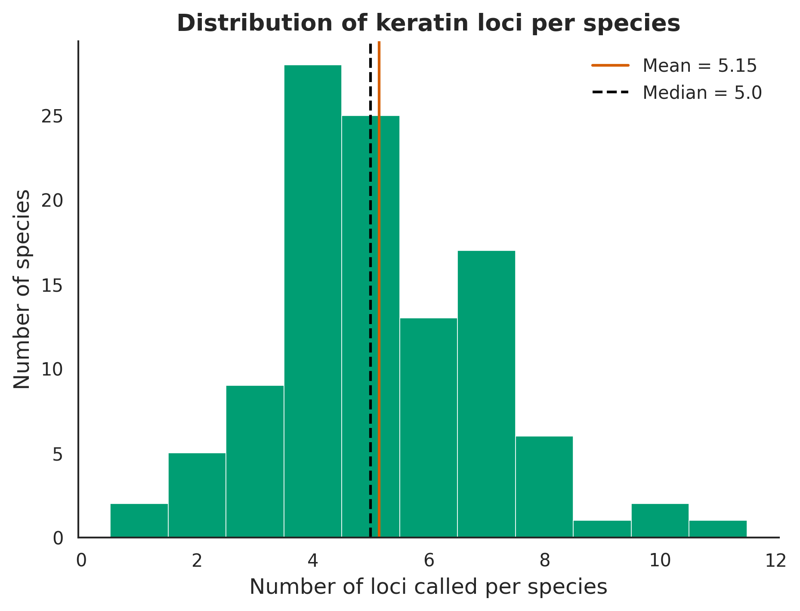
  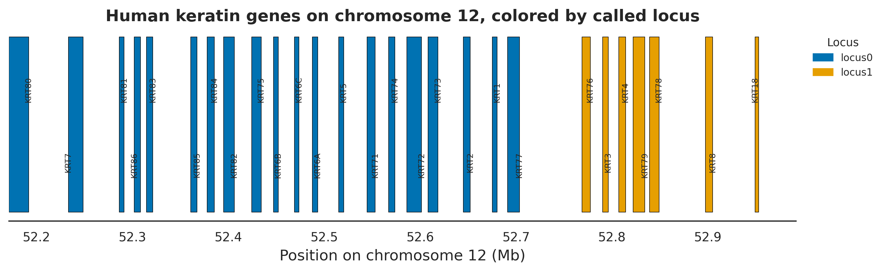

---

## Semester Project '26: Heptad alignment of the coiled-coils

### Why not a whole-sequence MSA

Keratins have a conserved central coiled-coil flanked by head and tail domains. The heads and tails are low-complexity, glycine/serine-rich and very variable in length, so whole-sequence MSAs fill up with gaps. Trees built from them had several unrealistically long branches. This project therefore uses only the coiled-coil domain; heads and tails will be attached back later.

### Why align by heptad register

Keratins form Type I / Type II heterodimers whose helices wind around each other as a coiled coil. The sequence repeats every seven residues (positions `a b c d e f g`):

| Position | Role |
|---|---|
| `a`, `d` | mostly hydrophobic; form the core between the helices (knobs-into-holes packing) |
| `e`, `g` | often charged; form inter-chain salt bridges |
| `b`, `c`, `f` | face the solvent |

Since a residue's role depends on its heptad position, `a` should be compared with `a` and `d` with `d`. A standard MSA does not know the register and can shift sequences by a few residues, lining up a core residue against a surface one.

### Data

CoCoNat per-residue coiled-coil predictions for **4494 sequences** (64 keratins, ~121 mammal species). Each residue has a heptad position (`a`–`g`) or is non-coil (`i`).

### Method

1. Split each sequence into coiled-coil segments (consecutive runs of `a`–`g`).
2. Cut each segment into heptads; skipped positions (e.g. `abc--fg`) become gaps, no residue is removed.
3. Align within each segment using a **heptad-level Needleman–Wunsch**: the unit is a whole heptad, so slot `a` always faces slot `a` and a missing heptad is a 7-residue gap. Heptads are scored by summing **BLOSUM62** over their 7 slots, with a gap penalty. (Plain stacking, heptad 1 under heptad 1, was rejected because one missing heptad shifts everything after it.)
4. Align each sequence to its group's representative (mostly human) and merge the pairwise alignments (centre-star).
5. Drop all-gap columns and tabulate heptads per segment and in total.

**Sample KRT2 alignment, heptad-based Needleman–Wunsch:** the conserved `ELNNMQDLVED` motif lines up in one column.

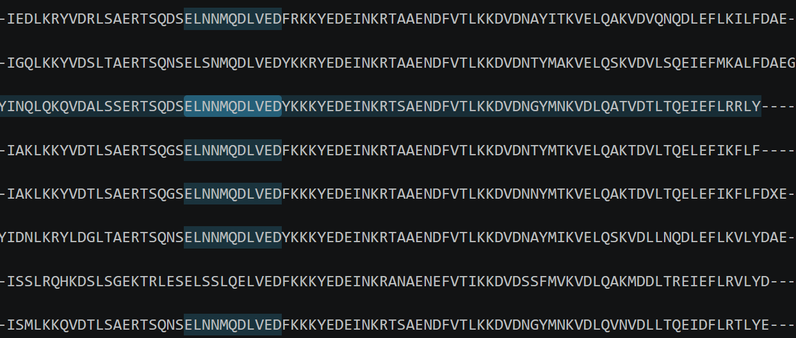

**Same sequences with simple heptad stacking**, for comparison:

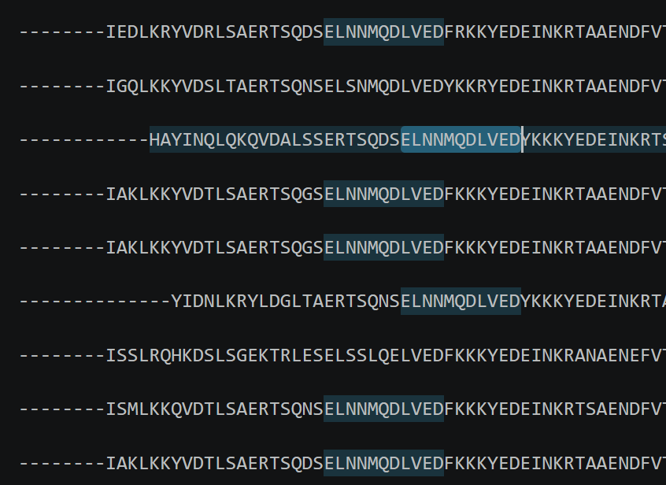

### Outputs

`results_all_segments`

### Future work

- Build trees from the coiled-coil alignments: keratin-wise, species-wise, and Type I vs Type II.
- Compare them with the earlier whole-sequence trees, especially the long-branch cases.
- Attach the head and tail domains back to the coiled-coil alignment.

---

## Tools

UniProt / UniRef100 · CoCoNat · MAFFT · IQ-TREE · EBI Proteins API · Python (Needleman–Wunsch with BLOSUM62)
