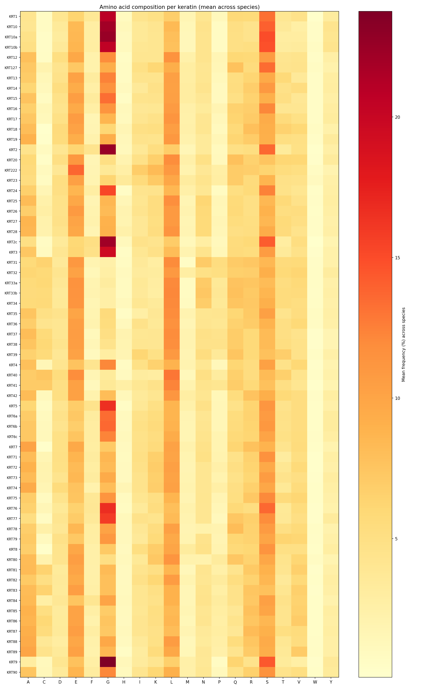
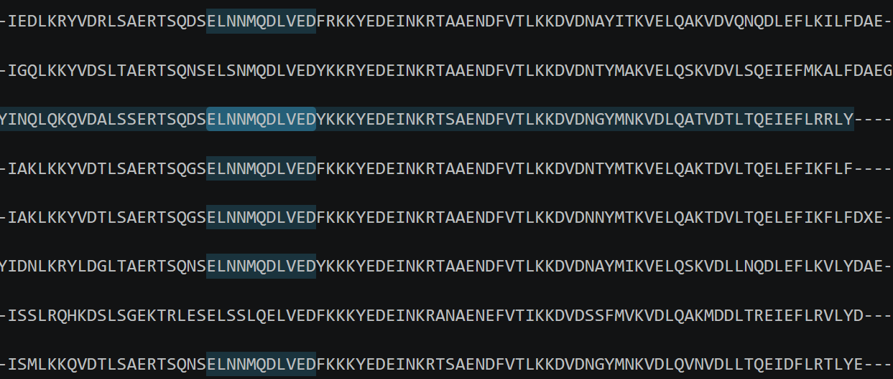
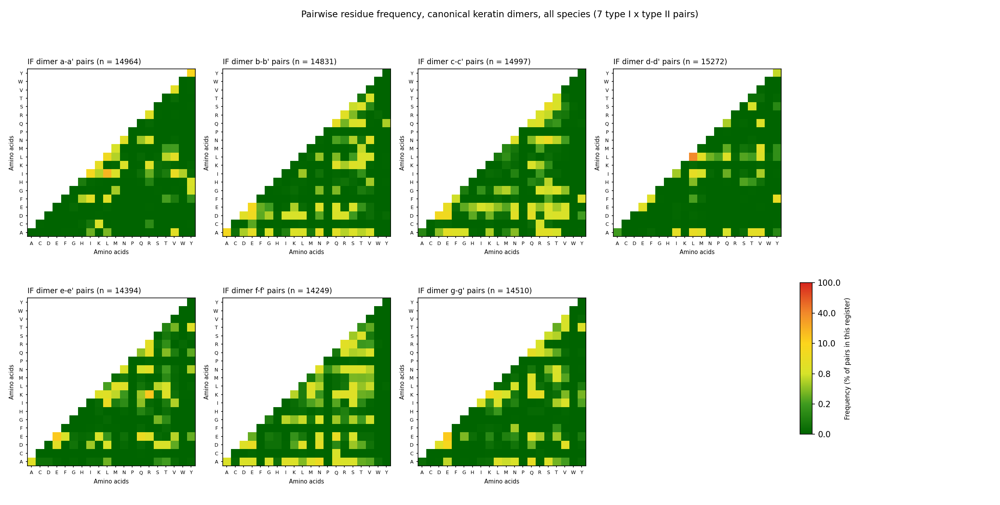

# Mammalian Keratin Analysis

Keratin genes across ~120 mammals: dataset, domains, phylogeny, synteny, and a heptad-register alignment of the coiled-coil rod.

**Author:** Tanishq Milani

| | Project | Page |
|---|---|---|
| 1 | [Summer '26](#summer-26-dataset-domains-trees-synteny): dataset, head/tail analysis, coiled-coil prediction, MSAs, trees, synteny | [index.html](https://kazu-ds.github.io/keratin-project/) |
| 2 | [Semester '26](#semester-26-heptad-alignment-of-the-coiled-coils): heptad-register alignment of the rod, coil 2A, linkers, pair frequencies | [august26.html](https://kazu-ds.github.io/keratin-project/august26.html) |

---

## Summer '26: dataset, domains, trees, synteny

- **Data:** keratins parsed from UniProt reference proteomes; fragments, KAPs and sequences under 300 aa removed; longest isoform kept; classified Type I / II. Final set: **120 organisms, 4442 keratins** (at least 15 keratins per organism).
- **Heads and tails:** mapped from human boundaries onto keratin-wise MSAs. Canonical Type I / II partners have similar head and tail lengths (r = 0.84 and 0.83); Ser/Thr/Tyr content correlates weakly in the tail (r = 0.22).
- **Coiled coils:** CoCoNat predicts shorter coils than the MSA-based annotation (difference peaks near −80 aa).
- **Trees:** MAFFT + IQ-TREE (MFP) for each keratin, each type and the full set.
- **Synteny:** coordinates for 4135 accessions, loci called with chromosome-specific MAD thresholds.

---

## Semester '26: heptad alignment of the coiled-coils

Whole-sequence MSAs are dominated by variable heads and tails. Here only the rod is used, aligned by **heptad register** (`a`–`g`) so core `a`/`d` positions meet core positions. Data: CoCoNat register calls for 4494 sequences (64 keratins, ~121 mammals). Method: heptad-level Needleman–Wunsch (BLOSUM62 over 7 slots, centre-star merge).

| Step | What was done | Key result |
|---|---|---|
| **Coil 2A** | CoCoNat never calls 2A (19 aa). Carried over from ortholog alignments via the human table; register inferred | Same frame `cdefgabcdefgabcdefg` in all 54 keratins; PCOILS agrees at 97–100% (consistency check only) |
| **KRT18 fix** | CoCoNat merged 1A + L1 + 1B in 92 of 103 sequences; L1 cut out, alignments re-run | `*_L1fix` outputs |
| **Rod lengths** | Heptads per block, type I vs II, canonical pairs | Rod 35 vs 33 heptads (type I longer); 2A = 3 heptads everywhere; type II proteins longer overall (534 vs 452 aa) |
| **Linkers** | L1, L12, L2 by human boundaries (2A excluded) | L12 61% identical within type, 14% between; canonical partners no more similar than random (p = 0.25, 0.61, 0.51) |
| **Pair frequencies** | Neelesh-style heatmaps, a–a' to g–g', 7 canonical dimers, all species | d–d' Leu–Leu 39.8%; a–a' Ile–Leu 22.5% |

**Limits:** everything except 2A rests on CoCoNat's calls; the 2A register is inferred, not checked against a structure; the pair heatmaps have no comparison set.
**Next:** trees from the alignments (keratin-wise, species-wise, Type I vs II); attach heads and tails; test which rod block separates canonical partners from non-partners.

Details and all figures: [august26.html](https://kazu-ds.github.io/keratin-project/august26.html)

---

**Tools:** UniProt · CoCoNat · FAMSA · MAFFT · IQ-TREE · PCOILS · EBI Proteins API · Python
